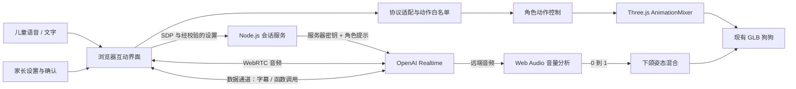
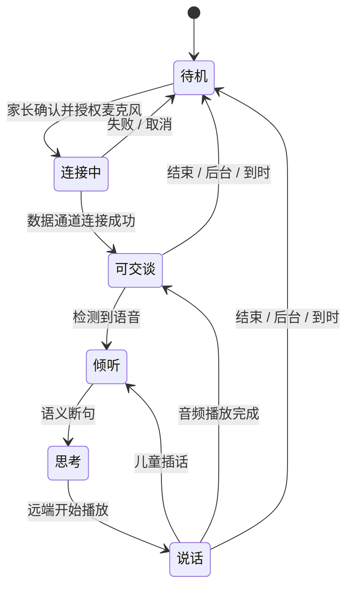

# 天天儿童互动服务：产品与技术设计

版本：MVP 0.2，声音与动作增强。

以下为 MVP 0.2 设计基线。2026-09-09 起继续进行上线改造，新增访问控制、会话持久恢复与部署模板；当前状态、实现边界和完整验收统一记录在 [RELEASE.md](RELEASE.md)，其中有关鉴权和恢复的更新优先于以下历史描述。

2026-09-12 更新：默认独立轻量模型，新增有限状态的分支故事和三轮猜动物游戏。`shared/activities.js` 管理 17 个场景及澄清/停止回复；选择、提示、跳过、重复和主动道别可连续进行。内容仅在本页会话中保存，安全预设优先于游戏分支，旧播放回调不能推进新一轮。配音清单扩展为 74 段、自动测试 48 项通过。以下 36 段和 26 项为历史基线。

本版补充：本地演示默认播放 36 段打包的瑶瑶角色配音，支持明亮活泼与温柔讲故事两种风格。实时语音默认改为 coral，可通过 `OPENAI_CUSTOM_VOICE_ID` 接入已获服务方批准创建的定制音色；现有音色不声称复刻动画原声。家长设置提供试听和自然／活泼／夸张三档动作。动作由原始片段的独立副本增强，默认头部相对旋转幅度约 1.7 倍、尾部约 1.85 倍，带角度上限；增加开心小跳、飞行升高和说话点头。打包配音使用真实音频音量驱动下颌。本版实测覆盖了配音播放结束、动作档位与 26 项自动检查；OpenAI 实时声音和定制音色仍需有效账号联调。

## 1. 产品定义与目标

孩子面前是一只会呼吸、倾听、说话和做动作的虚拟小狗。孩子用日常语言表达，小狗用短句自然回应，并通过姿态和动作表达情绪。家长能理解服务在做什么，随时结束互动。

第一版默认中文普通话，4–8 岁，单个儿童和一只角色一对一互动。设备需要屏幕、麦克风、扬声器和支持 WebRTC/WebGL 的浏览器。当前先完成桌面原型；同一套交互可扩展到平板、触屏一体机或嵌入式设备。

体验设计强调三个指标：孩子能否自然开始；说完后是否有及时反馈；角色动作是否与表达一致。首轮不做付费激励、排名、持续签到、开放网络搜索或长期儿童画像。

## 2. 用户流程与场景

家长选择服务、表达年龄和单次时限。首次真实语音需说明接收方和用途并获得确认，再由浏览器请求麦克风。孩子进入花园后直接说话；模型断句后回答，字幕辅助家长理解，动作自然融入回应。随时可打断、静音和退出。到时断开会话、关闭麦克风、清除字幕并提示休息。

| 场景 | 儿童输入示例 | 角色回应目标 | 动作 |
| --- | --- | --- | --- |
| 初见 | “你是谁？” | 说明自己是屏幕里的 AI 小狗，短句介绍 | 抬爪问好 |
| 开心分享 | “我今天画画了！” | 关注具体经历，温和邀请孩子继续说 | 摇尾 |
| 情绪表达 | “我有点难过” | 接纳感受，鼓励现实支持，不制造依赖 | 平静待机 |
| 好奇探索 | “为什么有彩虹？” | 用简单准确的语言解释，不编造 | 歪头 |
| 故事 | “讲个小兔子的故事” | 每次一小段、一次一个选择 | 好奇 / 眨眼 |
| 游戏 | “我们玩吧” | 坐着能参与的猜动物、数数 | 邀请玩耍 |
| 动作请求 | “你会飞吗” | 强调是屏幕中的想象表现 | 展翼起飞 |
| 听不清 | 背景噪声 / 不完整语句 | 请孩子慢慢重复，不假装听懂 | 倾听反馈 |
| 结束 | 到时 / 家长结束 | 道别或休息页，不催促延长 | 回待机 |

本地演示匹配预设意图并维护有限场景状态，不具有真正语言理解；未知或模糊选择会请求澄清。演示输入“再见”在配音播放结束后自动断开。真实模型模式由上下文完成连续互动；其语音“再见”的回应由模型生成，自动断开仍依靠时限或结束按钮，后续需增加服务器控制的结束机制。

## 3. 架构



选用浏览器 + Three.js + Node.js，便于复用 GLB、快速验证和跨屏幕运行。WebRTC 负责音频编码、实时传送和播放，不在应用内自行实现 PCM 编解码。服务器只参与会话建立和关闭，不中转音频。真实产品需要集中内容审核时，应在此架构上增加服务器控制通道或受控语音流水线。

### 会话状态



说话状态依据音频播放缓冲事件，不依据 `response.done`：模型生成完毕时，设备可能还在播放。这可以避免音频尚未播完就合嘴。打断时取消生成并清空 WebRTC 输出缓冲；旧回复后续动作与字幕被忽略。连接、页面关闭、取消授权等待等异步路径都需要释放媒体资源。

### 模型到角色的动作契约

```json
{
  "name": "perform_behavior",
  "arguments": { "action": "wave", "emotion": "warm" }
}
```

| action | 原模型 clip | 执行规则 |
| --- | --- | --- |
| idle | Idle_Breathe | 持续循环 |
| wave | Hello_Wave | 播放一次 |
| happy | Happy_Tail | 播放一次 |
| curious | Curious_Look | 播放一次 |
| sniff | Sniff | 播放一次 |
| play | Play_Bow | 播放一次 |
| wink | Wink | 播放一次 |
| walk | Walk | 约 4.5 秒后回待机 |
| trot | Trot | 约 4.5 秒后回待机 |
| fly | Takeoff_Hover | 完整起飞、悬停、落地后回待机 |

情绪限制为 `warm / happy / curious / calm`，目前用于对话和角色旁的提示语；动作自身携带原有眼睑动画。没有额外生成高精度情绪形态键。

函数名、动作名、情绪均需校验；未知动作与错误 JSON 返回失败，额外代码字段丢弃。同一次回复最多执行一个动作，重复 call_id 不重复执行。工具结果回传后，后续说话请求禁用工具，防止递归动作调用。

嘴部用 `Mouth_OpenClose` 片段的 `jaw.quaternion` 提取闭合和最大张开姿态。每帧先应用动作，再依据远端语音 RMS 音量覆盖下颌，并做阻尼平滑。这是音量口型，不是音素级口型。下一版可补 A/E/I/O/U、M/B/P、F/V 等口型，并接 TTS viseme 时间戳；若实时模型不输出 viseme，可用音频驱动模型推断，但需要单独评估延迟。

## 4. 服务切换与扩展

所有浏览器 provider 统一以下契约：

```javascript
connect(settings, consent) // 完成连接或抛出可解释错误
sendText(text)             // 发送文字补充
interrupt()                // 停止生成 / 播放
setMuted(boolean)          // 实際禁用音轨，不只改变图标
resumeAudio()              // 处理浏览器声音暂停
level()                    // 返回角色口型使用的 0..1 音量
disconnect()               // 释放麦克风、RTC、音频图和服务器会话
```

向 UI 发出的事件包括 `state`、`transcript`、`delta`、`speaking`、`behavior`、`expires`、`notice` 和 `error`。这些事件与厂商字段隔离。

新增其他厂商时，增加 provider 文件和工厂注册，并新增对应服务器会话路由。厂商使用 WebSocket 或“ASR → LLM → TTS”时，在 provider 内处理格式、播放和取消机制，保持上述契约；不能假设修改 OpenAI URL 就能兼容。密钥、签名和厂商特定鉴权继续留在服务器。

对于需要严格审核后才能播音的儿童服务，可以采用 ASR → 文本审核 → LLM 结构化回复 → 输出审核 → 分段 TTS。它能在播放前拦截文本，代价是更长首音延迟。当前原生实时语音是低延迟原型，**系统提示不等于经过验收的内容审核系统**。

## 5. 儿童体验与数据边界

当前角色提示约束短句、普通话、一次一个问题、听不清先确认。避免索要个人信息、制造排他依赖、要求保密或诱导购买；遇到危险或严重困扰，引导寻找身边可信赖的大人。演示模式还有少量确定性意图兜底，它不能替代全面审核。

本应用不创建账号，不上传照片，不采集摄像头，不录音到磁盘，不持久化文字对话。浏览器只留最多 40 条临时字幕；清空按钮清除显示，结束会话再关闭远端连接。关闭会话不等于删除服务方按其政策保留的数据。API key 不返回前端；服务器不记录音频、字幕、SDP 或上游错误原文。

OpenAI 的未成年人指引要求在处理 13 岁以下或当地数字同意年龄以下儿童个人数据前落实 API 零数据保留；还要求年龄适当的披露、安全内容、监控报告和风险升级措施。原型默认仅成年人测试。将 `CHILD_USE_ENABLED` 设为 true 只是应用开关，不是 ZDR 开通，也不是法规合规证明。[官方未成年人指引](https://developers.openai.com/api/docs/guides/safety-checks/under-18-api-guidance)

正式试用前的产品工作包括：核实组织与接口的数据保留能力、建立有效家长同意和撤回渠道、年龄适配评估、危险内容审核、人工风险处置与举报入口、明确数据删除范围及授权主体。当前原型没有真实家长账户、年龄核验、人工监控或报警渠道，不会声称已经通知家长或救援人员。

## 6. 性能、成本与稳定性

当前模型约 106.2 MiB，约 242 万三角面、194 个网格、40 根变形骨骼，11 段原始动画。直接复用确保模型与动画可追溯，但不适合不经优化就投放低端平板。当前限制像素比，避免细毛的实时阴影重复绘制，提供隐藏细毛的省电显示。首次仍需下载完整模型。

移动端下一步：生成独立 LOD、保留面部和轮廓毛、减少躯干毛束、合并材质与网格、压缩纹理、验证骨骼与眼睑没有退化。建议的工程目标是模型 10–25 MiB、10–30 万三角面，再由目标设备实测调整；这些不是当前已实现结果。

| 指标 | 目标（尚未实测真实语音） | 测量方式 |
| --- | --- | --- |
| 说完到首音 | P50 < 1.2 秒，P95 < 2.5 秒 | 语音断句至音频播放开始 |
| 本地打断 | < 150 ms | 点击 / VAD 事件至音量归零 |
| 动作反馈 | 指令到开始 < 100 ms | 解析完成至首个改变帧 |
| 桌面渲染 | 持续 ≥ 30 fps | 指定硬件、完整模型和动态口型 |
| 会话资源释放 | 结束后无活跃麦克风轨道 | 浏览器权限指示与轨道检查 |

单次回复上限设为 512 输出 token；会话上限 5/10/15 分钟；一分钟最多尝试 5 次创建，本机最多 3 个已创建会话。服务器使用计时器发出 hangup，客户端同时到时断开；服务器挂断失败会输出不含儿童信息的诊断。进程重启后内存时限记录会丢失，生产需持久化短期会话租约、失败重试和账单配额。

费用按供应商的音频输入、音频输出、文字 / 上下文 token 与时长共同计算。实现阶段不在页面声称固定每分钟成本；联调时采集去标识化 usage 与延迟，不记录孩子原始语音和自由文本，再计算每有效互动分钟成本及并发预算。

## 7. 本机实现与线上服务的边界

| 已实现 | 正式服务仍需 |
| --- | --- |
| 127.0.0.1 本机运行、发布构建 | HTTPS 域名、鉴权、部署运维 |
| 同源 token、Host 校验、内存限流 | 家长身份、每用户配额、共享限流存储 |
| 服务端初始化角色提示 | 受控服务器会话通道，防止不可信客户端更改策略 |
| 动作参数校验、事件去重 | 连续语音和对抗输入的内容安全测试 |
| 到时关闭和资源清理 | 跨进程会话租约、重试与成本硬上限 |
| 模型动作复用 | 移动 LOD、音素口型、目标平板实机验证 |

现有资产是依据 Skye / 天天角色重建的模型；上线或商业发布前需要核实角色、形象和素材授权，或换用有明确使用权的原创角色。工程中的动作契约能继续复用，只需替换 GLB 与 clip 映射。

## 8. 验收与后续推进

当前自动测试覆盖动作与真实 GLB 的对应关系、下颌轨道、非法工具、重复执行、打断后的迟到事件、缓冲音频口型状态、快速文字输入、麦克风静音与资源释放、后端确认与数据校验、密钥不泄漏、会话创建与挂断、限流和上游错误处理。

已在本机浏览器验证模型加载、飞行请求、情绪回应、家长设置、时限更改、模式切换、无密钥提示和会话结束后的字幕清理。真实 OpenAI 的音频接收、合成播放、字幕与动作时序、中文童声识别、打断感受与延迟仍需要有效密钥和目标网络实测。自动测试使用模拟上游，不代表真实服务端到端成功。

建议推进顺序：

1. **成年人联调**：配置密钥，验证 20 轮中文对话、连续插话、背景噪声、拒绝权限、网络断开和费用记录。
2. **小规模受控试用准备**：落实儿童数据处理、家长授权、内容审核与人工处置；准备原创或已授权资产。
3. **平板优化**：生成并回归检查独立轻量模型；对目标设备验证长时间帧率、温度和内存。
4. **在线服务**：增加身份、会话管理、集中配额、监控和可靠性措施，再部署 HTTPS 环境。

协议依据：[WebRTC 会话](https://developers.openai.com/api/docs/guides/realtime-webrtc)、[实时对话与工具](https://developers.openai.com/api/docs/guides/realtime-conversations)、[会话挂断](https://developers.openai.com/api/reference/python/resources/realtime/subresources/calls/methods/hangup)。
